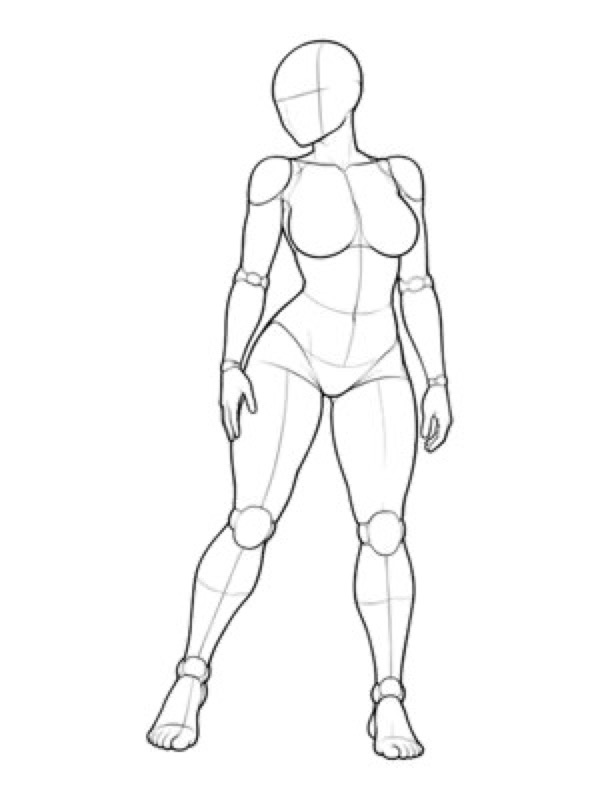
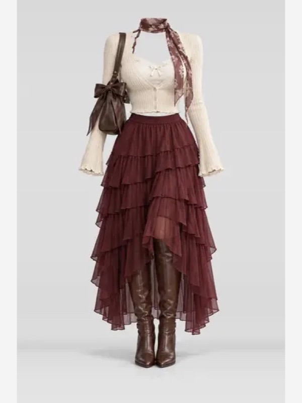
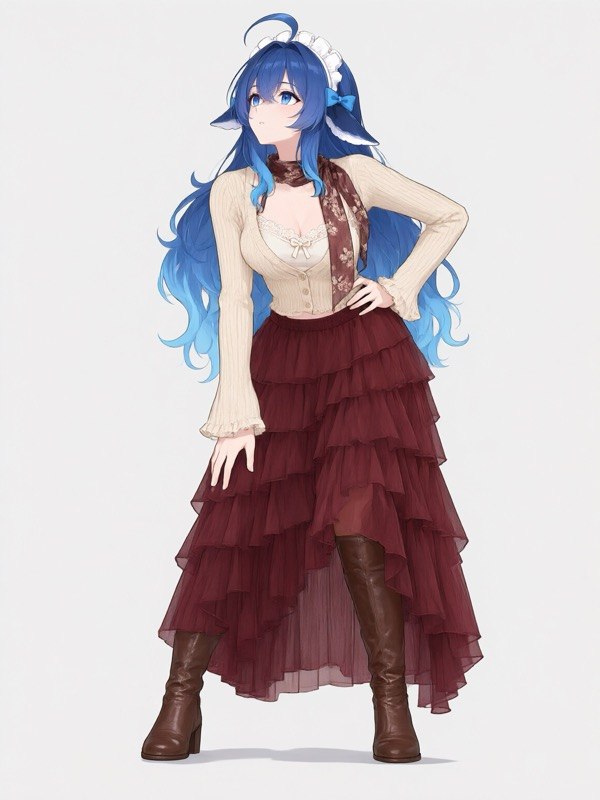

# PoseCloset

> 姿态工坊 · 交互式「姿势 + 服装」生图 Skill：在库内选姿势与服装、提供主体，确认后调用宿主渲染器出图。

[](https://github.com/miyuki-shirogane/PoseCloset)


-green)


在库内选姿势和服装、上传主体，确认后出图。分类、候选、批次锁定和状态流转都在代码里，不靠模型自觉。

- **不会编造**：姿势/服装只来自索引
- **不会乱生成**：确认方案后才提交
- **不绑模型**：先用 `mock` 跑通流程，再用 `host` 接任意出图服务

## 效果

示例生成时使用了用户上传的主体、姿势参考与服装参考，`style=anime`、`3:4`、`1152×1536`。主体由用户自由上传；本例使用了一张非官方社区角色图（DeepSeek 鲸鱼娘，CC BY-NC-SA 4.0）：

| 主体参考（测试） | 姿势参考 | 服装参考 | 成品 |
|---|---|---|---|
|  |  |  |  |

> 示例仅用于**非商业预览**；主体只是一次测试，Skill 支持任意用户上传的人像。姿势与服装图的上游授权不允许再分发，`docs/gallery` 里的两张预览图仅为直观展示，商用前请删除或替换。详见 [素材授权与风险](#素材授权与风险)。

## 特性

- **索引驱动**：分类、候选、编号全部来自索引；索引里没有的不提供、不联想。
- **候选可控**：默认每批 5 项，可指定数量（≤20）和姿势子类（如「10 个站姿」）；编号在当前批有效，旧批次的项可用 id 选。
- **状态机**：`pose_category → pose_option → outfit_category → outfit_option → subject → spec_confirm → rendering → completed/failed`。
- **幂等**：同一会话重复提交只产生一次任务；失败可安全重试。
- **三张参考图**：主体 / 服装 / 姿势，各司其职；画风默认跟随主体。
- **比例策略**：主体含身体时比例取自主体，仅脸时取自姿势图。
- **半身构图**：bust 姿势自动前置姿势图、加 `FRAMING` 裁切约束、过滤下半身/鞋类关键词，并保留服装参考图。
- **配件清单**：从服装关键词解析帽子、包、眼镜等，prompt 首尾强调，并在结果中返回 `checklist`。
- **平台中立**：`render/base.py` 定义 `capabilities / submit / poll`，`mock` 可离线跑通全流程。
- **素材合规**：路径白名单、禁止镜像、商用模式强制禁用非商用姿势库。

## 工作流

```text
CLI / MCP
   │
   ▼
tools.py ──► session.py (SQLite, TTL, 幂等)
   │              ▲
   ├──► library.py ──► index/pose_outfit_index.json
   ├──► security.py ──► SSRF / 上传校验 / 注入清洗
   ├──► prompt_builder.py ──► 正向 / 负向 / 参考图角色
   └──► render/base.py ──► mock | host ──► 宿主的生图服务
```

## 快速开始

1. **获取并安装**：

   ```bash
   git clone https://github.com/miyuki-shirogane/PoseCloset.git
   cd PoseCloset
   ```

   把目录放到 agent 的 skills 目录，或把 `SKILL.md` 交给支持 skill 的 agent。
2. **选模型**：推荐 `qwen-image-3.0`（3 张参考图，正好主体/姿势/服装）；需要更多参考图可用 `wan2.7-image`（最多 9 张）。
3. **说一句话**：

   > 用 pose-outfit skill，主体用这张图，给我 10 个站姿、夏装，生成一张 3:4 的图。

   主体画风（`anime` / `photo` / `3d`）由用户指定，Skill 不会自动猜；不确定时 agent 应先问。

先用 `POSE_RENDERER=mock` 可以零成本跑通流程；真出图时在宿主接一个出图服务即可（见下方 `host`）。

## 开发者：CLI、MCP 与渲染后端

### CLI

```bash
export POSE_STATE_DIR=/tmp/pose-outfit-state
export POSE_RENDERER=mock
python3 -m poseoutfit.cli list-tools
python3 -m poseoutfit.cli call start_pose_task '{"user_id":"u1"}'
```

### MCP stdio

由客户端自动拉起，不监听端口、不需要常驻服务：

```json
{
  "mcpServers": {
    "pose-outfit": {
      "command": "python3",
      "args": ["-m", "poseoutfit.cli", "serve"],
      "cwd": "/absolute/path/to/PoseCloset",
      "env": { "POSE_STATE_DIR": "/tmp/pose-outfit-state", "POSE_RENDERER": "mock" }
    }
  }
}
```

### host 渲染后端

`mock` 是内置的假渲染器：不调用模型、不联网，返回一张占位图，用来零成本跑通流程。`host` 是真实渲染器：由你提供两条命令，一条提交、一条轮询，接哪个模型由你决定。

实现两条命令即可，Skill 只负责拼 prompt、组织参考图、推进状态：

```bash
export POSE_RENDERER=host
export POSE_RENDER_COMMAND='./render.sh'
export POSE_RENDER_POLL_COMMAND='./poll.sh'
```

- `POSE_RENDER_COMMAND`：stdin 读 `{"spec","assets","idempotency_key"}`，stdout 输出 `{"run_id":"..."}`。
- `POSE_RENDER_POLL_COMMAND`：stdin 读 `{"run_id":"..."}`，输出 `{"status":"RUNNING|COMPLETED|FAILED","images":[{"url":"..."}],"error":{...}}`。
- 需要 ControlNet 时在 `POSE_RENDER_CAPABILITIES` 声明 `"supports_controlnet": true`，`assets.pose.control_type` 为 `lineart`。
- 本地 ComfyUI：把 `assets.*.ref_url` 下载到 `input/`，跑工作流，轮询 `/history/{prompt_id}`。
- 上游偶发 `reference_media_unavailable` 时，建议宿主做**有界重试**（仅在终态失败、未扣费时换新幂等键重试 1–2 次）。

`spec` 中已包含 `prompt.positive / negative / reference_hint / reference_order`；参考图顺序为 **主体 → 服装 → 姿势**。

## 工具

| 工具 | 作用 |
|---|---|
| `start_pose_task` | 新建会话，返回 `session_id` |
| `get_session_state` | 当前状态、已选项、批次、风险、可用动作 |
| `get_pose_categories` / `get_outfit_categories` | 有效分类与数量 |
| `sample_pose_options` / `sample_outfit_options` | 默认取 5 项；可传 `subcategory`（姿势）与 `limit`（≤20）；`reshuffle=true` 换一批 |
| `select_pose` / `select_outfit` | 锁定当前批次内的项 |
| `receive_subject` | 收人像/URL/文字描述，登记 `scope` 与 `subject_style` |
| `set_spec` | 比例、尺寸、张数、种子、画风；返回 `risks` |
| `confirm_and_render` | 用户确认后提交，返回 `run_id` |
| `get_render_status` | 轮询结果，返回图片、署名与 `checklist` |
| `go_back` / `reset_task` | 回退一步 / 重来 |

## 素材索引

索引是构建产物，不手工维护：

```bash
python3 scripts/build_index.py                    # 从上游 catalog 生成
python3 scripts/build_index.py --check            # 只校验
python3 scripts/build_index.py --pose-source a.json --costume-source b.json
```

当前产物：**98 个姿势**（全身 73 + 上半身 25）、**1014 套服装**（春/夏/秋/冬/派对）。

- 只保存 id、名称、分类、关键词、公开相对路径与授权字段，**不下载图片**。
- 构建期丢弃白名单外条目；加载期再次校验，发现异常整体拒绝。
- 路径必须匹配白名单正则，只允许两个素材 origin。

## 画风、比例与配件

- `receive_subject(..., scope=face|upper|full, subject_style=anime|photo|3d)`。
- 主体含身体：比例、头身比、体型、画风取自主体图；姿势图只提供关节位置与构图。
- 主体仅脸：比例取自姿势图，主体图只提供五官与身份。
- 服装图只提供版型与长度，不提供人体比例；prompt 明确“不要为了服装改变身体比例”。
- 画风默认沿用 `subject_style`，`set_spec(style=...)` 可覆盖。
- 配件（帽子/包/眼镜等）会单独成行并在首尾强调；结果返回 `checklist.accessories` 供核对。
- 半身姿势（`bust`）：参考顺序为 `pose → subject → outfit`，prompt 增加 `FRAMING: upper-body portrait ...`，负向加入 `full body, legs, feet, lower body`；服装关键词会移除下半身/鞋类，但**服装参考图仍然保留**。

## 配置

| 变量 | 默认 | 说明 |
|---|---|---|
| `POSE_DEPLOYMENT` | `personal` | `commercial` 时上游姿势库被禁用 |
| `POSE_LIBRARY` | `upstream` | 设为 `own` 时索引里不得再有上游姿势，否则启动失败 |
| `POSE_RENDERER` | `mock` | `mock` / `host` |
| `POSE_STATE_DIR` | `~/.local/state/pose-outfit` | SQLite 与会话文件 |
| `POSE_INDEX` | `index/pose_outfit_index.json` | 索引路径 |
| `POSE_SESSION_TTL_HOURS` | `24` | 会话过期 |
| `POSE_SESSION_MAX_BATCH` | `5` | 每批候选默认值（上限 20） |
| `POSE_ASSET_TIMEOUT` | `20` | 取图超时（秒） |
| `POSE_ASSET_MAX_BYTES` | `12000000` | 素材大小上限 |
| `POSE_SUBJECT_MAX_BYTES` | `10000000` | 主体图片大小上限 |
| `POSE_RENDER_TIMEOUT` | `120` | host 单条命令超时 |
| `POSE_RENDER_CAPABILITIES` | — | JSON 覆盖 capabilities |

## 测试与 CI

```bash
python3 -m unittest discover -s tests -t . -v
```

覆盖：状态守卫、批次锁定、换一批与耗尽重开、自定义数量/子类、旧批次选择、半身 framing、不足 5 项、授权闸门、源头排除与防篡改、无运行期开关、请求边界、路径与 SSRF、规格校验、幂等、注入清洗、画风/比例/配件、源站不可达、全链路。

GitHub Actions 见 `.github/workflows/ci.yml`，在 Python 3.9–3.12 上跑同一套测试。

## 已知限制

- 参考图模型不等于姿态迁移模型。姿势、比例、配件都可能漂移，**不保证像素级还原**。
- 姿势素材是线稿，弱参考模型可能把线稿风格带进成品；prompt 已加约束。
- 小配件（帽子、眼镜、包）面积小，容易被模型忽略；本仓库用首尾强调 + 清单提高概率，但不能保证。
- 上游图片服务存在间歇性 `reference_media_unavailable`；失败通常不扣费，建议宿主有界重试。
- 没有视觉审核与局部重绘能力，无法自动判断“帽子有没有戴上”。
- 想要稳定锁姿态，需要 ControlNet（openpose/depth）或专用 try-on 模型。

## 素材授权与风险

**重要：本仓库的代码许可不覆盖任何第三方素材。**

| 素材 | 权利人 | 授权要点 | 本仓库处理 |
|---|---|---|---|
| 姿势线稿 | ギア（AI Pose Gallery） | 上游说明**不得用于商业用途** | 索引只存编号/名称/URL；`docs/gallery/pose.jpg` 为 1 张非商业预览；商用模式整体禁用 |
| 服装图 | ギア（COSTUME-DB-01） | 允许作为创作参考；**禁止再分发、转载、转售图像数据** | 索引只存编号/关键词/URL；`docs/gallery/outfit.jpg` 为 1 张非商业预览，商用/再分发前必须删除 |
| 测试主体 | 上善无形 / ZipZipPipe | **CC BY-NC-SA 4.0**（署名、非商业、相同方式共享；非官方社区角色） | 内置 `docs/gallery/subject.jpg`，仅非商业演示 |
| 成品示例 | 本项目生成 | 衍生自上述素材，仅非商业演示 | 仅内置 `docs/gallery/result.jpg` |

- 商用部署前必须把姿势库替换为自有或已授权素材（`POSE_LIBRARY=own` 并重建索引），否则接口返回 `LICENSE_BLOCKED`。
- 示例预览图仅用于非商业演示；商用、再分发或打 Release 前请删除 `docs/gallery/pose.jpg` 与 `docs/gallery/outfit.jpg`。
- 测试主体图为 CC BY-NC-SA 4.0（非官方社区角色）；本仓库与 DeepSeek 无关联。
- 生成图的权利状态取决于所用素材与模型条款；不要默认可用于商业用途。

完整授权说明：[licenses/THIRD_PARTY.md](licenses/THIRD_PARTY.md)。

## 目录结构

```text
poseoutfit/            核心实现（仅标准库）
  config.py            配置与分类白名单
  library.py           索引加载、schema 校验
  assets.py            路径校验、按需取图（内存缓存）
  session.py           SQLite 会话、TTL
  state_machine.py     状态与 allowed_actions
  prompt_builder.py    画风 / 比例 / 配件 / 参考图角色
  security.py          SSRF、上传校验、注入清洗
  tools.py             14 个工具
  cli.py               CLI 与 MCP stdio
  render/              base / mock / host
index/                 构建产物与 schema
scripts/build_index.py 生成索引（不下载图片）
docs/gallery/          示例与非商业声明
licenses/              第三方授权
tests/                 78 项测试
```

## 致谢

- [wzc520pyfm/gen-ai-pose-image](https://github.com/wzc520pyfm/gen-ai-pose-image)：本项目的素材组织方式、姿势/服装参考思路与索引来源整理受该项目启发。本项目与其无隶属关系。
- ギア：AI Pose Gallery 与 COSTUME-DB-01 的作者。
- Anhao：[ai-pose-gallery-zh](https://github.com/anhao/ai-pose-gallery-zh) 的中文译名维护者。
- 上善无形 / ZipZipPipe：示例角色设定图。

## 贡献

见 [CONTRIBUTING.md](CONTRIBUTING.md)。提交前请确保：

```bash
python3 -m unittest discover -s tests -t .
python3 scripts/build_index.py --check
```

## License

代码：[MIT](LICENSE)。第三方素材与示例图片**不在 MIT 范围内**，见 [licenses/THIRD_PARTY.md](licenses/THIRD_PARTY.md)。
