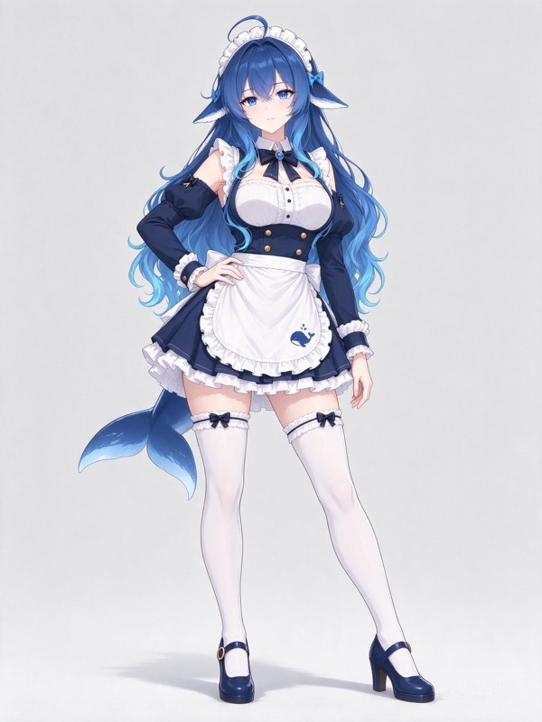
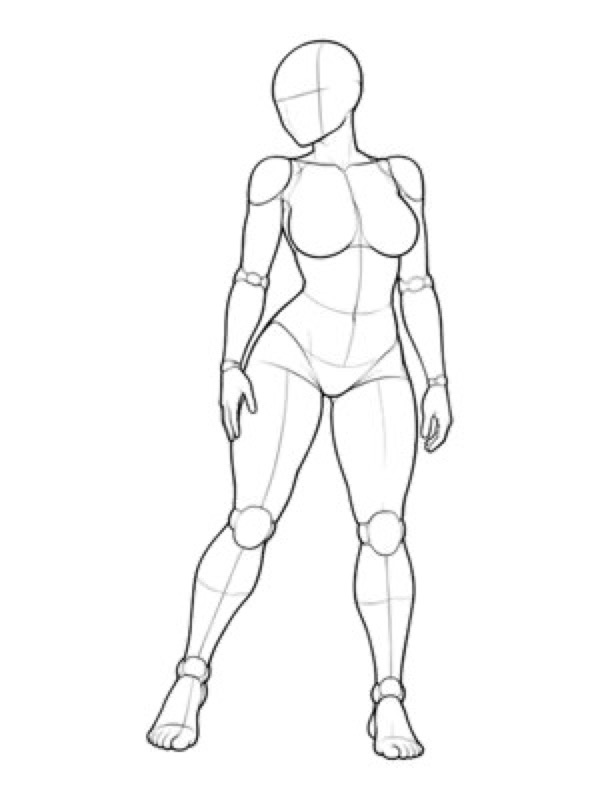
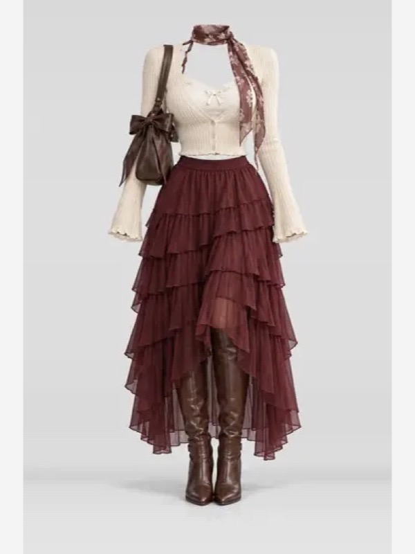
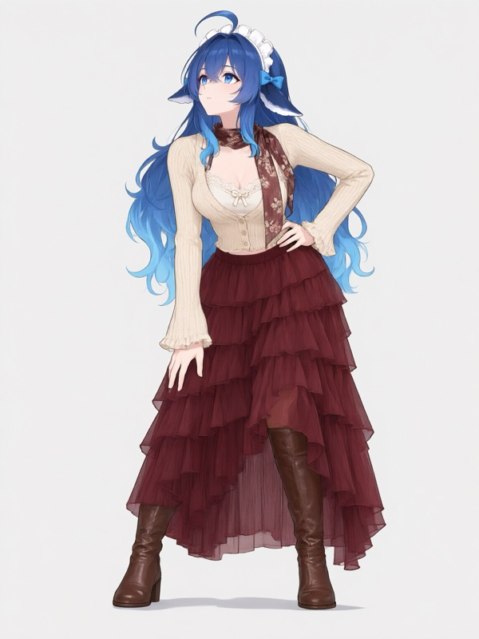

# 示例

| 主体参考（测试） | 姿势参考 | 服装参考 | 成品 |
|---|---|---|---|
|  |  |  |  |

预览图统一为 `600×800`（3:4），空白处使用浅灰留白，便于并排对比。

示例参数：`style=anime`、3 张参考图（主体 / 姿势 / 服装）、`3:4`、`1152×1536`、`n=1`。主体由用户自由上传；本例使用了一张非官方社区角色图（DeepSeek 鲸鱼娘，CC BY-NC-SA 4.0）。

## 授权与风险

- 主体：上善无形 / ZipZipPipe，**CC BY-NC-SA 4.0**（署名、非商业、相同方式共享；非官方社区角色）。
- 姿势：ギア / AI Pose Gallery，**上游说明不得用于商业用途**。
- 服装：ギア / COSTUME-DB-01，**禁止再分发、转载或转售图像数据本身**。
- 成品：由上述素材生成，仅用于本项目非商业演示。

> 为了让你直观看到输入与输出，本目录内置了姿势与服装各一张预览图。这**不改变**上游授权，也不代表获得商用许可；如果你要商用或再分发，请先删除 `pose.jpg`、`outfit.jpg`，或替换为你拥有权利的素材。

完整说明见根目录 [licenses/THIRD_PARTY.md](../../licenses/THIRD_PARTY.md)。
